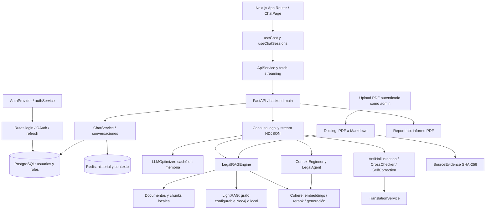

# Auditoría de IA Jurídica: primero restaurar seguridad y fiabilidad

**Fecha:** 1 de octubre de 2026, America/Lima. **Estado:** auditoría realizada sobre el árbol de trabajo; seguimiento de correcciones al 5 de octubre de 2026; evidencia original conservada como histórica.

**Conclusión:** no recomiendo exponer esta versión a usuarios reales hasta retirar el modo debug de chat, rotar la credencial de base de datos incrustada y corregir autenticación, carga del corpus y recuperación RAG. Hay buenas bases de ingestión, pruebas y validación, pero las métricas favorables de mantenibilidad no demuestran que el producto funcione de forma segura.

## Estado de los hallazgos — seguimiento 05/10/2026

`[x]` = corrección implementada y verificada localmente; `[ ]` = pendiente o parcialmente mitigado. No representa aprobación de despliegue ni certificación de calidad jurídica.

- [ ] A01 — Credencial incrustada: rotación pendiente.
- [ ] A02 — Identidad/persistencia: rutas mitigadas; integridad de persistencia pendiente.
- [ ] A03 — Adaptadores de autenticación.
- [ ] A04 — OAuth/JWT/cookies.
- [ ] A05 — Contrato frontend de autenticación.
- [x] A06 — Loader, readiness y cierre.
- [x] A07 — Candidatos relevantes y abstención.
- [x] A08 — Traducción completa y fallo explícito.
- [x] A09 — Pipeline validado compartido.
- [ ] A10 — Vigencia jurídica y procedencia temporal.
- [x] A11 — Actualización compatible y audits sin avisos conocidos.
- [x] A12 — Contratos y errores HTTP.
- [x] A13 — Contexto e identidad de caché.
- [ ] A14 — Cobertura/lint/barrera de entrega; tests mejorados, pendiente cierre completo.
- [x] A15 — Manifiesto, locks y export generado.
- [ ] A16 — Concurrencia y operación distribuida.
- [x] A17 — Redacción y política operativa documentada; controles de despliegue abajo.
- [ ] A18 — Complejidad/rutas alternativas.

**Verificación actual:** `pnpm test`: **222 Python pasan, 3 evaluaciones remotas omitidas por opt-in y 2 xfail temporales conocidos; 14 Node pasan**. Build Next/Tailwind/TypeScript pasa. Instalación runtime limpia Windows:200 paquetes, `uv pip check` compatible. PDF sintético con ReportLab/PyPDF/backend Docling/Markdown pasa, sin OCR/modelos descargados. `pnpm deps:check` pasa. Audits: Python199 paquetes, frontend233 y herramientas raíz24 dependencias: **0 avisos conocidos**.

Evidencia: [tests-final.log](D:/Web/IA_juridica/temp/audit-fixes-2026-10-05/tests-final.log), [pip-latest.json](D:/Web/IA_juridica/temp/audit-fixes-2026-10-05/pip-latest.json), [pnpm-latest.json](D:/Web/IA_juridica/temp/audit-fixes-2026-10-05/pnpm-latest.json), [pnpm-root-latest.json](D:/Web/IA_juridica/temp/audit-fixes-2026-10-05/pnpm-root-latest.json). Las secciones originales preservan diagnóstico histórico; sus números de línea no son referencias actuales.

## 1. Qué hacer primero

| Orden | Hallazgo                                                | Acción inmediata                                                                                 |
| ----- | ------------------------------------------------------- | ------------------------------------------------------------------------------------------------- |
| 1     | A01: credencial PostgreSQL en configuración versionada | Rotarla en el proveedor, retirar el literal y revisar exposición. No basta con borrar la línea. |
| 2     | A02: chat/stream sin principal; éxitos ficticios       | Restaurar sesión/identidad y propiedad de conversaciones; eliminar mocks del runtime.            |
| 3     | A03–A05: contratos de autenticación rotos             | Unificar cookies, JWT, OAuth y acceso inicializado a PostgreSQL.                                  |
| 4     | A06–A07: carga del corpus y recuperación sesgada      | Corregir lifespan; recuperar candidatos por consulta, no por orden de inserción.                 |
| 5     | A08–A10: traducción, validación y vigencia jurídica | Evitar pérdida de texto; compartir pipeline; comprobar fuentes y fechas efectivas.               |
| 6     | A11: dependencias con avisos de seguridad               | Actualizar por grupos verificables, empezando por superficie web y parsers.                       |
| 7     | A12–A18: contratos, calidad y operaciones              | Hacer verdes tests/lint y medir cobertura antes de refactors generales.                           |

**Prioridades:** P0 = contención inmediata de un secreto potencialmente expuesto; P1 = corregir antes de despliegue real; P2 = siguiente ciclo de estabilización; P3 = simplificación posterior. Son prioridades de esta auditoría, no equivalentes a las severidades de Sonar.

**Evidencia:** “reproducido” significa una prueba local con integraciones simuladas; “inspección” significa código/configuración revisados; “riesgo condicionado” requiere comprobar condiciones de despliegue. No se realizó explotación contra servicios reales.

## 2. Alcance y límites

- Backend Python/FastAPI: arranque, seguridad, rutas de consulta/chat, OAuth/JWT, PostgreSQL/Redis, RAG, ingestión PDF, validación, traducción y exportación PDF.
- Frontend Next.js/React: flujo de chat, sesiones, cliente HTTP, autenticación, compilación, TypeScript y dependencias.
- Configuración: manifiestos Python/Node, Sonar, Docker, Render, launcher y descubrimiento de tests.
- CodeGraph se utilizó antes de localizar/leer código indexado, para fuentes actuales y rutas de llamadas. Después se contrastaron hallazgos con compilación y pruebas.
- Se respetaron los numerosos cambios preexistentes. HEAD de referencia: `fe376f5b6e749e6cfc01c5e0d83916e139ef5c31`; los resultados corresponden al **working tree**, no exclusivamente a ese commit.
- Se crearon este informe y evidencias en [directorio de auditoría](D:/Web/IA_juridica/temp/audit-2026-10-01). En la auditoría inicial no se corrigió código; ahora se documentan correcciones posteriores. No se hizo commit, no se desplegó ni se rotaron credenciales.
- No se ejecutaron consultas legales reales contra proveedores LLM, pruebas destructivas, carga concurrente, migraciones ni pruebas E2E con bases de datos reales. La veracidad jurídica y la calidad del quechua requieren evaluación especializada.
- **Sonar:** se incorporaron la captura y los siete extractos de seguridad entregados por el usuario, contrastados manualmente con el código actual. Esta sesión no tiene herramientas MCP Sonar activas ni token heredado; su API autenticada devolvió 401 y el navegador existente no pudo conectarse mediante la herramienta. No se inventaron rule keys ni issue IDs. Quedan pendientes el listado completo de fiabilidad/mantenibilidad y la consulta autenticada del Quality Gate; no se atribuyen los demás hallazgos de esta auditoría a reglas de Sonar.

## 3. Qué significa el resultado de Sonar

| Métrica de Overall Code   |           Captura del usuario | Interpretación útil                                                       |
| -------------------------- | ----------------------------: | --------------------------------------------------------------------------- |
| Seguridad                  |              7 incidencias; E | Prioridad alta de revisión; no demuestra siete ataques explotables.        |
| Fiabilidad                 |             44 incidencias; E | Señal de defectos funcionales que merece revisar regla por regla.          |
| Mantenibilidad             |            141 incidencias; A | A no equivale a ausencia de deuda ni compensa seguridad/fiabilidad.         |
| Cobertura                  | 0.0%; 5.5k líneas por cubrir | El scanner no ha recibido cobertura útil; sí hay tests ejecutables.       |
| Duplicación               |             0.6%; 15k líneas | Baja duplicación textual; no descarta pipelines funcionalmente duplicados. |
| Accepted issues / Hotspots |                         0 / 0 | No constituye una certificación de seguridad.                              |

En [pyproject.toml](D:/Web/IA_juridica/pyproject.toml), Sonar tiene `sources="backend"`: **esta captura no representa el frontend**. El informe esperado es `coverage.xml` en la raíz, que no existe en el estado comprobado. La auditoría generó su XML en otra ruta, indicada abajo. Sonar no ejecuta ni genera cobertura por sí mismo; hay que producir Cobertura XML antes del scanner y configurar su ruta. [Documentación oficial de cobertura Python](https://docs.sonarsource.com/sonarqube-server/analyzing-source-code/test-coverage/python-test-coverage).

### Triaje de las siete incidencias de seguridad aportadas

Son **tres causas**, no siete mecanismos independientes de ataque:

| Extractos                      | Fuente actual                                                                                                                   | Evaluación y acción                                                                                                                                                                                                                                                     |
| ------------------------------ | ------------------------------------------------------------------------------------------------------------------------------- | ------------------------------------------------------------------------------------------------------------------------------------------------------------------------------------------------------------------------------------------------------------------------- |
| 1: bind a todas las interfaces | [run_dev_server.py](D:/Web/IA_juridica/backend/scripts/run_dev_server.py), línea 19                                             | Riesgo de exposición en desarrollo: usar loopback por defecto y habilitar acceso LAN explícitamente solo si se necesita. No cambiar a ciegas el bind de Docker, donde puede ser necesario.                                                                              |
| 2: seguridad del hash          | [file_utils.py](D:/Web/IA_juridica/backend/utils/file_utils.py), línea 82; uso en 151–184                                      | El uso observado es agrupar archivos duplicados, no contraseñas. No se confirmó vulnerabilidad de autenticación por esta línea. Cambiar a SHA-256 es una mejora razonable para evitar colisiones relevantes; no tratar este MD5 como prueba de procedencia jurídica. |
| 3–7: cinco cookies sin Secure | [auth_routes.py](D:/Web/IA_juridica/backend/modules/auth/routes/auth_routes.py), `set_cookie` en líneas 31, 40, 66, 267 y 276 | **Defecto confirmado de configuración para producción HTTPS**, incluido en A04: login access/refresh, renovación access y OAuth access/refresh. Centralizar la política de cookies y probar cada flujo.                                                         |

`HttpOnly` impide acceso desde JavaScript; no sustituye a `Secure`, que restringe el envío a transporte seguro según las reglas del navegador. Mantener HTTP de desarrollo local separado de HTTPS de producción. [Referencia de Set-Cookie](https://developer.mozilla.org/en-US/docs/Web/HTTP/Reference/Headers/Set-Cookie).

No recomiendo marcar en bloque las siete como aceptadas, ni aplicar cambios solo para conseguir una letra A. Debe quedar documentado por qué un bind es necesario y qué papel tiene un hash, y corregir el comportamiento real de las cookies.

### Resultados locales verificables

| Comprobación                                         | Resultado                                                                             | Evidencia                                                                                   |
| ----------------------------------------------------- | ------------------------------------------------------------------------------------- | ------------------------------------------------------------------------------------------- |
| Pytest combinado, ambos directorios                   | **139 pasan, 2 fallan, 4 xfail**; 145 casos                                     | [pytest-coverage.log](D:/Web/IA_juridica/temp/audit-2026-10-01/pytest-coverage.log)          |
| Cobertura de`backend`, incluyendo archivos de tests | 3087/6721 sentencias =**45.93%**                                                | [coverage.json](D:/Web/IA_juridica/temp/audit-2026-10-01/coverage.json)                      |
| Cobertura recalculada excluyendo`/tests/`           | 2143/5769 sentencias =**37.15%**                                                | [summary.json](D:/Web/IA_juridica/temp/audit-2026-10-01/summary.json)                        |
| TypeScript                                            | Pasa, sin errores                                                                     | [typescript.log](D:/Web/IA_juridica/temp/audit-2026-10-01/typescript.log), vacío por éxito |
| Build frontend                                        | Pasa; cinco rutas estáticas generadas                                                | [frontend-build.log](D:/Web/IA_juridica/temp/audit-2026-10-01/frontend-build.log)            |
| Lint frontend                                         | Falla:`next lint` se interpreta como directorio inexistente                         | [frontend-lint.log](D:/Web/IA_juridica/temp/audit-2026-10-01/frontend-lint.log)              |
| Tests del launcher, invocación documentada con pnpm  | **7/7 pasan**                                                                   | [dev-full-tests-pnpm.log](D:/Web/IA_juridica/temp/audit-2026-10-01/dev-full-tests-pnpm.log)  |
| Ruff                                                  | 844 resultados: 811 fuera de tests, 33 en tests; principalmente estilo/modernización | [ruff.json](D:/Web/IA_juridica/temp/audit-2026-10-01/ruff.json)                              |
| Bandit                                                | 16 alertas: 1 alta, 6 medias, 9 bajas; necesitan triaje                               | [bandit.json](D:/Web/IA_juridica/temp/audit-2026-10-01/bandit.json)                          |
| pip-audit                                             | 209 paquetes inspeccionados, 31 afectados, 283 incidencias de avisos                  | [pip-audit.json](D:/Web/IA_juridica/temp/audit-2026-10-01/pip-audit.json)                    |
| pnpm audit                                            | 51 reportes: 2 críticos, 25 altos, 20 moderados, 4 bajos                             | [pnpm-audit.json](D:/Web/IA_juridica/temp/audit-2026-10-01/pnpm-audit.json)                  |

La cobertura excluyendo tests todavía incluye scripts operativos/debug del backend; **no es una métrica exclusivamente del código de producción**, ni es directamente comparable con las líneas que Sonar decide cubrir. Se midieron sentencias, no cobertura de ramas. Los avisos de dependencias no equivalen a ese número de vulnerabilidades explotables en esta aplicación.

El build advierte que los datos de Browserslist están desactualizados, pero completa compilación, TypeScript y generación estática. No prueba login, streaming ni persistencia reales.

## 4. Cómo funciona el proyecto



El diagrama refleja componentes y conexiones encontrados, **no una garantía de ejecución correcta**. Actualmente la autenticación JWT del frontend no impone por sí sola el principal de chat; existen identidades/sesiones paralelas. El loader del corpus también tiene un problema de ciclo de vida descrito en A06.

### Recorrido recomendado para entender el código

| Paso | Qué leer                                                                                                                                                                                                                                                                  | Responsabilidad y cuidado                                                                                 |
| ---- | -------------------------------------------------------------------------------------------------------------------------------------------------------------------------------------------------------------------------------------------------------------------------- | --------------------------------------------------------------------------------------------------------- |
| 1    | [página inicial](D:/Web/IA_juridica/frontend/app/page.tsx) → [ChatPage](D:/Web/IA_juridica/frontend/src/presentation/pages/ChatPage.tsx)                                                                                                                                   | Composición de pantalla y eventos del usuario.                                                           |
| 2    | [useChat](D:/Web/IA_juridica/frontend/src/application/legal/use-cases/useChat.ts), [useChatSessions](D:/Web/IA_juridica/frontend/src/application/legal/use-cases/useChatSessions.ts) y [ApiService](D:/Web/IA_juridica/frontend/src/application/legal/services/apiService.ts) | Sesión, HTTP, chunks y evento final. El cliente auth sigue otro circuito.                                |
| 3    | [main.py](D:/Web/IA_juridica/backend/main.py)                                                                                                                                                                                                                               | Composition root, lifespan, upload y orquestación de las consultas. Mezcla demasiadas responsabilidades. |
| 4    | [motor RAG](D:/Web/IA_juridica/backend/modules/rag/services/lightrag_engine.py)                                                                                                                                                                                             | LightRAG, candidatos locales y reranking; separar respuesta generada de documentos recuperados.           |
| 5    | [ContextEngineer](D:/Web/IA_juridica/backend/context/context_engineering.py), [LegalAgent](D:/Web/IA_juridica/backend/agents/pydantic_agents.py)                                                                                                                             | Construcción de prompt y generación. Revisar el prompt realmente enviado, no solo el construido.        |
| 6    | [ResponseValidator](D:/Web/IA_juridica/backend/modules/validation/services/response_validator.py), [traducción](D:/Web/IA_juridica/backend/modules/language/services/translation_service.py)                                                                                | Heurísticas, corrección y adaptación de idioma; no certifican exactitud jurídica.                     |
| 7    | [ChatService](D:/Web/IA_juridica/backend/modules/chat/services/chat_service.py), [PostgreSQLAdapter](D:/Web/IA_juridica/backend/database/postgres_adapter_final.py), [RedisAdapter](D:/Web/IA_juridica/backend/database/redis_adapter.py)                                     | Persistencia y propiedad; los mocks actuales impiden confiar en resultados exitosos.                      |
| 8    | [pipeline de ingestión](D:/Web/IA_juridica/backend/ingestion/pipeline.py), [Docling](D:/Web/IA_juridica/backend/ingestion/docling_processor.py), [SourceEvidence](D:/Web/IA_juridica/backend/ingestion/source_evidence.py)                                                   | Fuente → Markdown → evidencia → índice. Evidencia de conversión no equivale a norma vigente.         |

Los módulos de compatibilidad bajo [backend/rag](D:/Web/IA_juridica/backend/rag) y [backend/validation](D:/Web/IA_juridica/backend/validation) no deben confundirse con todos los servicios activos bajo [backend/modules](D:/Web/IA_juridica/backend/modules). Qdrant está en configuración de infraestructura, pero no se verificó que participe en la ruta principal de consulta revisada.

## 5. Hallazgos de seguridad y autenticación

### A01 — P0: credencial de base de datos incrustada

**Estado:** confirmado por inspección, vigencia del secreto no comprobada. **Fuente:** [render.yaml](D:/Web/IA_juridica/render.yaml), líneas 15–16, `DATABASE_URL`; Git confirma que el archivo está versionado.

La URL contiene credenciales literales. No se reproduce su valor en este informe ni se probó acceso a la base. Si siguen vigentes, quien obtenga el repositorio/configuración puede disponer de esas credenciales.

**Corrección:** el propietario debe rotarlas en el proveedor, comprobar actividad y alcance, mover el valor a un secreto del entorno y evaluar exposición en historial Git/copias. Borrar el literal no revoca el secreto. **Aceptación:** credencial anterior revocada; configuración sin secretos; despliegue usa credencial nueva de mínimo privilegio; revisión de historial documentada.

### A02 — P1: chat sin identidad y persistencia simulada

**Estado:** reproducido. **Fuentes:** [chat_routes.py](D:/Web/IA_juridica/backend/modules/chat/routes/chat_routes.py), líneas 24–26, 131–157 y 235–240; [main.py](D:/Web/IA_juridica/backend/main.py), líneas 651–664; [chat_service.py](D:/Web/IA_juridica/backend/modules/chat/services/chat_service.py), líneas 238–255 y 507–509.

El principal utiliza `Depends(lambda: None)` y se sustituye por `debug-user`. Crear una conversación sin sesión devuelve 200 con ese propietario; borrar un identificador inexistente devuelve `success=true`; un stream cacheado anónimo también devuelve 200. Hay respuestas de conversación/mensaje que no representan una escritura real.

**Impacto:** controles de propiedad inoperantes y falso éxito de persistencia; consultas sin sesión pueden consumir recursos. **No se demostró extracción de conversaciones privadas**, pues parte de la ruta es simulada. La política puede permitir usuarios anónimos, pero debe exigir una sesión firmada propia, no una identidad compartida.

**Corrección:** restaurar `require_principal`, verificar propietario antes de leer/generar/escribir y retirar mocks de producción. **Aceptación:** sesión ausente rechazada; dos sesiones aisladas; creación persiste; eliminación comprueba filas afectadas; caída de DB devuelve 503 redacted. Evidencia: [reproducciones](D:/Web/IA_juridica/temp/audit-2026-10-01/reproductions.json).

### A03 — P1: login, perfil y refresh usan adaptadores sin inicializar

**Estado:** inspección y reproducción del objeto recién creado. **Fuentes:** [AuthService](D:/Web/IA_juridica/backend/modules/auth/services/auth_service.py), líneas 6–19 y 55–64; [auth_routes.py](D:/Web/IA_juridica/backend/modules/auth/routes/auth_routes.py), líneas 23 y 98; [PostgreSQLAdapter](D:/Web/IA_juridica/backend/database/postgres_adapter_final.py), líneas 650–653.

Cada instancia crea un adaptador cuya conexión es `None`, sin llamar a `initialize`. Buscar un usuario con ese adaptador devuelve `None` y se transforma en “credenciales incorrectas”. El callback Google sí inicializa su adaptador: los flujos no comparten el mismo contrato.

**Corrección:** inyectar una dependencia inicializada/pool administrado por lifespan; distinguir credenciales erróneas de indisponibilidad de DB. **Aceptación:** login y `/auth/me` funcionan con usuario real en DB desechable; DB caída produce 503 genérico, no 401/404 engañosos. No se intentó autenticar cuentas reales durante esta auditoría.

### A04 — P1: OAuth/JWT/cookies tienen protecciones y contratos incompletos

**Estado:** inspección y reproducción de URL/payload. **Fuentes:** [auth_routes.py](D:/Web/IA_juridica/backend/modules/auth/routes/auth_routes.py), líneas 163–178, 259–280 y cookies en 35/44/70; [seguridad JWT](D:/Web/IA_juridica/backend/modules/auth/services/security.py), líneas 9–10; [refresh](D:/Web/IA_juridica/backend/modules/auth/services/auth_service.py), línea 63.

1. La URL OAuth no incorpora `state` ni PKCE, y el callback no valida el `state` recibido. Falta una vinculación verificable entre inicio y retorno del flujo. Adoptar las defensas adecuadas al proveedor y validar un valor único asociado a la sesión. [OAuth Security BCP, RFC 9700](https://www.rfc-editor.org/rfc/rfc9700.html).
2. El callback Google firma datos `user_id/email`, mientras refresh busca `sub`. Esa renovación no puede localizar correctamente al usuario bajo el contrato actual.
3. Las cookies JWT tienen `secure=False`; los secretos JWT admiten valores por defecto públicos. La variable `SECRET_KEY` de configuración no sustituye automáticamente a `JWT_SECRET_KEY`/`JWT_REFRESH_SECRET_KEY`. El riesgo de firma falsificable depende de desplegar sin estas variables; no se afirmó que la instancia actual use el valor por defecto.
4. `/auth/reset-admin-password` es una ruta sin autenticación que devuelve material de cuenta demo y una plantilla SQL; **no ejecuta un reset en la base de datos**. Debe retirarse del servicio público. El mismo hash precalculado se usa al crear cuentas OAuth, con comentarios contradictorios sobre su contraseña. No se probó qué contraseña corresponde al hash: deshabilitar autenticación por contraseña para cuentas solo OAuth en vez de asignarles una contraseña común.

**Aceptación:** callback rechaza state ausente/distinto/reutilizado; payload uniforme para login/OAuth; refresh válido funciona y el revocado falla; producción no arranca sin secretos JWT fuertes; cookies Secure en HTTPS; estrategia SameSite/CORS probada con los dominios reales. No almacenar tokens en localStorage para “arreglar” el frontend.

### A05 — P1: el frontend conserva un contrato de tokens incompatible con cookies

**Estado:** reproducido con respuestas HTTP simuladas. **Fuente:** [authService.ts](D:/Web/IA_juridica/frontend/src/application/legal/services/authService.ts), líneas 76–105, 116–135, 182–206 y 283–284.

Un login exitoso carga el usuario mediante `/auth/me`, pero no establece `this.token`. `isAuthenticated` sigue dependiendo de ese token: resultado observado `login_succeeded=true`, `user_loaded=true`, `is_authenticated=false`. La renovación también exige un refresh token en memoria aunque el backend lo espera en una cookie HttpOnly. El wrapper de solicitudes reintenta mediante recursión; debe tener un límite ante 401 persistente.

**Corrección:** estado de sesión derivado del perfil validado por el servidor; inicialización al cargar; refresh por cookies con un único reintento y coordinación entre solicitudes. **Aceptación:** login, OAuth, recarga, expiración, refresh y logout E2E; 401 persistente no genera bucle. Evidencia: [frontend-reproductions.json](D:/Web/IA_juridica/temp/audit-2026-10-01/frontend-reproductions.json).

## 6. Hallazgos de RAG y calidad de las respuestas

### A06 — P1: el loader pesado no se ejecuta en el lifespan activo

**Seguimiento 05/10/2026:** Lifespan único con tarea supervisada, reintentos acotados, cancelación y cierre. Estados loading/ready/degraded/failed/stopped; `/ready` y queries dan 503 durante carga/fallo. Markdown se lee en hilo; no reingesta LLM al arrancar. Launcher espera `/ready`. Pruebas de loader una vez, retry, fallo y cancelación/cierre.

**Evidencia histórica del 01/10 (las líneas pueden haber cambiado):**

**Estado:** reproducido con inicializadores externos simulados. **Fuente:** [main.py](D:/Web/IA_juridica/backend/main.py), lifespan en 164, configuración de app en 275–279 y loader registrado mediante `on_event` en 289–295; [RAG](D:/Web/IA_juridica/backend/modules/rag/services/lightrag_engine.py), líneas 248–267.

FastAPI usa el lifespan personalizado y no los handlers legacy `on_event` simultáneamente. El ensayo del lifespan activo produjo **cero llamadas al loader pesado**, aunque existe un handler startup registrado. Con `LOAD_LOCAL_KG` desactivado, la disponibilidad del corpus local queda especialmente comprometida. No implica que ninguna ruta pueda producir texto: LightRAG y fallbacks pueden responder de otra forma. [Comportamiento oficial de FastAPI](https://fastapi.tiangolo.com/advanced/events/).

Además, `initialize_storages` marca `_storages_initialized=True` incluso tras una excepción o sin una instancia RAG. Esa bandera no representa necesariamente disponibilidad real.

**Corrección:** integrar creación/carga/cancelación de tareas en un solo lifespan; estados `loading/ready/degraded/failed` explícitos; readiness depende del corpus y storage requeridos. **Aceptación:** loader llamado una vez; primer query dispone de corpus esperado; error de inicialización no aparece como ready; retry acotado funciona; cierre espera/cancela tareas.

### A07 — P1: el documento pertinente puede quedar fuera antes del reranking

**Seguimiento 05/10/2026:** BM25 sobre todos los chunks, sin prefijo por inserción; combinación con chunks reales de `LightRAG.aquery_data`, no respuestas generadas. Orden estable, deduplicación, scores positivos y abstención sin coincidencias. Pruebas con 81 chunks y corpus reordenado. No implementa selector de vigencia A10: dos xfail conservan ese límite.

**Evidencia histórica del 01/10 (las líneas pueden haber cambiado):**

**Estado:** reproducido. **Fuente:** [query_with_rerank](D:/Web/IA_juridica/backend/modules/rag/services/lightrag_engine.py), líneas 439–459.

Se recorren todos los chunks locales en orden de inserción y se toma el prefijo de candidatos, normalmente 50. No se selecciona primero ese conjunto por relevancia de la consulta. La respuesta de LightRAG se conserva como texto, no como lista de candidatos recuperados para esta fase.

Con 51 chunks, el relevante situado al final no aparece; colocándolo primero sí aparece. Aumentar `top_k` no soluciona el descarte previo. El fallback puede devolver resultados con score 0 sin un umbral de abstención.

**Corrección:** recuperación semántica/léxica/grafo que produzca candidatos por consulta; luego reranking; umbral y abstención cuando no haya evidencia suficiente. **Aceptación:** pruebas de recall con más de 50 chunks; invariancia al reordenar corpus; norma relevante recuperada; no convertir score bajo en certeza. Evidencia: [rag_insertion_order](D:/Web/IA_juridica/temp/audit-2026-10-01/reproductions.json).

### A08 — P1: traducción trunca texto sin avisar

**Seguimiento 05/10/2026:** Traducción completa por segmentos ≤4000, sin corte a1000; protege referencias/cifras/URL/saltos de línea. Fallo parcial, referencias perdidas o proveedor ausente no simulan éxito. Quechua muestra aviso de revisión; fallback conserva español. Regresiones de texto largo/citas/fallo parcial. No certifica fidelidad semántica jurídica ni quechua.

**Evidencia histórica del 01/10 (las líneas pueden haber cambiado):**

**Estado:** reproducido. **Fuente:** [TranslationService](D:/Web/IA_juridica/backend/modules/language/services/translation_service.py), líneas 106–111; [main.py](D:/Web/IA_juridica/backend/main.py), líneas 824–828.

El servicio corta a 1000 caracteres antes de traducir, incluso usando Google. El stream contempla otro límite de 5000, pero el límite interior prevalece. En un texto sintético de más de 1100 caracteres, se enviaron 1000 más `...`; desapareció el marcador final y se devolvió `success=true` sin señal de truncamiento.

**Impacto:** se pueden perder pasos, condiciones, citas y advertencias en una respuesta jurídica. La validación previa a traducción no valida lo que finalmente se muestra.

**Corrección:** segmentación preservando estructura, citas y términos; límite explícito/visible; validación posterior del resultado final. **Aceptación:** el contenido completo se conserva en respuestas largas; advertencia si falta una sección; evaluación bilingüe de quechua con hablantes competentes. Evidencia: [translation_truncation](D:/Web/IA_juridica/temp/audit-2026-10-01/reproductions.json).

### A09 — P1: distintos endpoints ofrecen distintas garantías de validación

**Seguimiento 05/10/2026:** Servicio compartido `backend/services/legal_queries.py` para normal/chat/stream: recuperación, prompt contextual, generación, validación, traducción. NDJSON bufferiza texto validado antes de emitir: aumenta latencia inicial pero evita borradores. Chat no entrega ni guarda asistentes ficticios ante errores. Sin evidencia se abstiene, no cachea certeza. Pruebas de equivalencia y persistencia posterior a validación.

**Evidencia histórica del 01/10 (las líneas pueden haber cambiado):**

**Estado:** inspección. **Fuentes:** [main.py](D:/Web/IA_juridica/backend/main.py), validación en 603, chunks en 779–787 y validación stream en 803; [ChatService](D:/Web/IA_juridica/backend/modules/chat/services/chat_service.py), líneas 303–465.

La consulta normal valida; el stream emite texto antes de su validación final; el pipeline duplicado de chat no llama al mismo `response_validator`. La sustitución final en la UI no impide que el usuario haya leído texto provisional erróneo. Chat además puede devolver una respuesta genérica tras excepciones y marcar `success=true`.

**Corrección:** servicio de consulta compartido con contrato de evidencia, validación, traducción y estados de degradación. Decidir si se bufferiza contenido o se identifica inequívocamente como borrador no validado. **Aceptación:** pruebas de equivalencia entre normal/chat/stream; no entregar un error como éxito; ninguna ruta omite validación comprometida al usuario.

### A10 — P1: conversión verificable no equivale a vigencia jurídica

**Estado:** carencia documentada y escenarios xfail existentes. **Fuentes:** [tests de reglas conflictivas](D:/Web/IA_juridica/tests/backend/bdd/test_conflicting_rules.py); [SourceEvidence](D:/Web/IA_juridica/backend/ingestion/source_evidence.py), líneas 36–44; [RAG](D:/Web/IA_juridica/backend/modules/rag/services/lightrag_engine.py), líneas 594–607.

Los tests reconocen que no existe selección temporal por fecha efectiva ni cadena trazable de acción modificadora. La evidencia de ingestión declara `provenance_state="unverified"`. En la ruta simple, las fuentes/confianza son placeholders o heurísticas basadas en longitud, no verificación jurídica.

**Corrección:** distinguir procedencia, integridad, jurisdicción y vigencia; referencias a fragmentos/página y fechas; resolver conflictos normativos antes de generar. **Aceptación:** corpus curado de derogaciones/enmiendas y fechas límite; fuentes identificables; cita realmente respalda la afirmación; “no hay evidencia suficiente” cuando proceda. El porcentaje de tests pasados no certifica asesoramiento legal correcto.

## 7. Dependencias, contratos y calidad

### A11 — P1: dependencias instaladas con avisos de seguridad

**Seguimiento 05/10/2026:** Actualizados manifiestos y locks al conjunto estable más reciente compatible con Python3.12/Node24. Audit runtime Python199 paquetes y frontend233 dependencias: **0 avisos conocidos**; artefactos `temp/audit-fixes-2026-10-05/pip-latest.json` y `pnpm-latest.json`. Tests/build/imports y PDF sintético verifican compatibilidad local, no seguridad absoluta ni proveedores remotos.

**Evidencia histórica del 01/10 (las líneas pueden haber cambiado):**

**Estado:** versiones y reportes verificados; explotación no probada. **Fuentes:** [lock frontend](D:/Web/IA_juridica/frontend/pnpm-lock.yaml), [uv.lock](D:/Web/IA_juridica/uv.lock), reportes audit de la sección 3.

Next instalado es **16.1.6**. Dos avisos críticos oficiales incluyen ejecución remota en servidores con filesystem Windows y ejecución remota en optimización de imágenes AVIF. Para esos dos avisos, la rama 16 se corrige desde **16.3.3**; esa cifra no garantiza resolver todos los demás avisos. El primero depende del despliegue Windows y las condiciones indicadas por el proveedor; el segundo, de procesar AVIF mediante el optimizador. Docker Linux no comparte el vector Windows. [Aviso Windows](https://github.com/vercel/next.js/security/advisories/GHSA-p293-qw3h-jr36), [aviso AVIF](https://github.com/vercel/next.js/security/advisories/GHSA-2xp9-vwfh-vxw4).

Python: priorizar superficie web y archivos externos (`python-multipart`, Starlette, parsers PDF/imágenes, Docling), después clientes/modelos y desarrollo. Ejemplos de incidencias reportadas: pypdf 6.7.0 (71), aiohttp 3.13.3 (48), Pillow 12.1.1 (35), LightRAG 1.4.9.11 (13). Esos conteos son avisos asociados a versiones, **no fallos distintos demostrados en las rutas activas**. El paquete local no publicado fue omitido por pip-audit.

**Corrección:** analizar alcance/advisory/versión fija, actualizar en grupos pequeños y congelar locks; no instalar “latest” indiscriminadamente. **Aceptación:** build/tests/imports/ingestión controlada pasan; nuevo audit revisado; excepciones tienen justificación y caducidad.

### A12 — P2: errores HTTP y entradas inconsistentes

**Seguimiento 05/10/2026:** Contrato común spanish/quechua y cadenas normalizadas no vacías (máximo8000), contexto acotado. HTTPException preservada: conversación ajena404 antes de persistencia/LLM, sesión ausente401, datos inválidos422, BD503 redactado, inesperados500 sin payload. Eliminados éxitos simulados de rutas chat; regresiones HTTP/seguridad.

**Evidencia histórica del 01/10 (las líneas pueden haber cambiado):**

**Estado:** reproducido y tests fallidos. **Fuente:** [main.py](D:/Web/IA_juridica/backend/main.py), modelo en 95–100 y catch de stream en 902–906; [test_security.py](D:/Web/IA_juridica/tests/backend/security/test_chat_security.py), líneas 174 y 200.

Una conversación ajena genera internamente 404 pero se captura y devuelve 500 con el texto de la excepción. Crear conversación devuelve 200 donde la prueba espera 503 por indisponibilidad. El esquema acepta una cadena formada por espacios; después de `strip` queda vacía. `language` acepta cualquier string en lugar de un contrato común con los idiomas soportados.

**Corrección:** preservar HTTPException, mapear errores de dominio sin detalles internos; validar tras normalización; enum de idiomas compartido. **Aceptación:** 404/401/403/422/503 distinguidos de 500; consultas vacías rechazadas; respuesta pública redactada. Fallos observados: `test_conversation_creation_returns_redacted_503` y `test_stream_rejects_foreign_conversation_before_persistence`.

### A13 — P2: caché e historial no representan el contexto completo

**Seguimiento 05/10/2026:** Historial privado:12 mensajes/6000 caracteres, JSON tratado como datos no instrucciones. SHA256 de propietario/conversación/historial/contexto/corpus/pipeline/modelo/idioma. Historial llega a generación y preguntas previas a retrieval. Cache solo fiable; deshabilitada para grafo remoto sin revisión compartida. A16 concurrencia/revisión distribuida sigue pendiente.

**Evidencia histórica del 01/10 (las líneas pueden haber cambiado):**

**Estado:** inspección; fuga entre usuarios no demostrada. **Fuentes:** [main.py](D:/Web/IA_juridica/backend/main.py), líneas 559 y 698; [ChatService](D:/Web/IA_juridica/backend/modules/chat/services/chat_service.py), líneas 353–389; [LLMOptimizer](D:/Web/IA_juridica/backend/optimization/llm_optimizer.py).

La clave usa consulta e idioma, no versión del corpus/pipeline ni contexto de conversación. Puede reutilizar una respuesta anterior después de subir nueva normativa. Chat construye contexto histórico pero la generación revisada no lo utiliza; aceptar un campo `context` no significa que influya en la respuesta.

**Corrección:** definir contrato de contexto y versión de corpus; cachear solo lo que resulte seguro compartir; invalidar al cambiar evidencia/pipeline; enviar historial acotado al prompt. **Aceptación:** segundo turno dependiente del primero funciona; actualización del corpus invalida respuesta antigua; dos contextos no reutilizan respuestas incompatibles. No añadir usuario a toda clave sin decidir primero qué contenido es público y cuál privado.

### A14 — P2: descubrimiento de tests, cobertura y lint no son una barrera de entrega

**Estado:** corrección parcial; permanece pendiente como barrera integral de entrega. **Fuentes actuales:** [pytest.ini raíz](D:/Web/IA_juridica/pytest.ini), [README tests](D:/Web/IA_juridica/tests/README.md), [package.json frontend](D:/Web/IA_juridica/frontend/package.json).

**Actualización — 06/10/2026:** las suites están unificadas en `tests/` por tipo; el runner ejecuta Python, Node y los cuatro unitarios del frontend. Se eliminó la configuración duplicada del backend, la guía única inventaría todos los casos y una regresión exige que no se dispersen ni queden sin documentar. Permanecen dos xfail temporales (ninguno de autenticación). Esto no resuelve por sí solo lint, cobertura suficiente ni una barrera CI de despliegue.

**Diagnóstico original — 01/10/2026:**

La configuración raíz y documentación usan `test` en singular, pero la suite está en `tests`; las dos suites requieren un comando explícito para obtener el conjunto comprobado. Hay cuatro xfail que mantienen visibles defectos conocidos, dos relacionados con autenticación; no deben ocultar una condición de despliegue inseguro. `next lint` no funciona con la versión instalada. No se encontró un directorio `.github` en este checkout; no se afirma que no exista CI externa.

Cobertura de áreas importantes: PostgreSQL **9.5%**, AuthService **21.2%**, rutas auth **21.5%**, chat service **27.7%**, traducción **23.2%**, RAG **40.3%**, generador PDF **0%**. La seguridad de sesión anónima tiene **97.4%**, pero no se aplica al stream actual. El validador tiene **84%**; no compensa una ruta que no lo invoca.

**Corrección:** un comando de tests consistente; promover bugs críticos a tests normales al corregir; ESLint explícito compatible; cobertura sin incluir tests; importación XML en Sonar y alcance frontend separado/ampliado. **Aceptación:** cero fallos y cero xfail de seguridad críticos; CI ejecuta tests, tipos, lint, build y audit triage.

### A15 — P2: configuración y manifiestos divergen

**Seguimiento 05/10/2026:** `pyproject.toml` + `uv.lock` fuente de verdad; requirements generado mediante `pnpm deps:export`, verificado con `pnpm deps:check`. Dev separado y pysonar solo grupo sonar opt-in. Locks Node sin latest flotante ni overrides antiguos. Instalación limpia Windows congelada verificada. User Token para MCP; Project Analysis Token para scanner. DeepEval runtime trae pytest transitivo.

**Evidencia histórica del 01/10 (las líneas pueden haber cambiado):**

**Estado:** inspección. **Fuentes:** [pyproject.toml](D:/Web/IA_juridica/pyproject.toml), [requirements.txt](D:/Web/IA_juridica/requirements.txt), [documentación Sonar](D:/Web/IA_juridica/docs/SONARQUBE.md), [package.json frontend](D:/Web/IA_juridica/frontend/package.json).

Hay dos definiciones de dependencias Python con versiones distintas; herramientas como pysonar están tanto en dependencias runtime como en un grupo sonar opt-in, contrario a la intención de opcionalidad documentada. Frontend declara `latest`, aunque el lock fija una versión antigua. La documentación debe distinguir **User Token para MCP** y **Project Analysis Token válido para scanner**, sin generalizar la restricción del MCP a todo Sonar.

**Corrección:** manifiesto principal + lock, grupos dev/sonar separados y exportación generada si otro despliegue necesita requirements; instalaciones frozen y actualización deliberada. **Aceptación:** instalaciones reproducibles en entorno limpio; despliegue sin herramientas innecesarias de desarrollo; ejemplos de tokens coherentes. No cambiar secretos ni grupos mientras todavía se decide el despliegue objetivo.

### A16 — P2: riesgos de concurrencia y disponibilidad no cubiertos por pruebas

**Estado:** riesgo arquitectónico, no pérdida de datos reproducida. **Fuentes:** [PostgreSQLAdapter](D:/Web/IA_juridica/backend/database/postgres_adapter_final.py), conexión compartida y operaciones en executor; [RAG](D:/Web/IA_juridica/backend/modules/rag/services/lightrag_engine.py), líneas 123–130; [Dockerfile backend](D:/Web/IA_juridica/backend/Dockerfile).

Varias operaciones utilizan una conexión psycopg compartida desde hilos, con transacciones que requieren aislamiento explícito. El almacén JSON se reescribe completo, sin publicación atómica/lock. El despliegue con varios workers mantiene caches, corpus y límites en memoria por proceso: un upload puede no ser visible en el otro worker. Parte del IO de archivos se ejecuta síncronamente desde rutas async.

**Corrección:** pool/transacción por operación; almacenamiento común/versionado o publicación atómica; cache/rate-limit compartidos cuando corresponda; mover trabajo pesado a worker con límites/timeout. **Aceptación:** carga de dos workers, uploads concurrentes, reinicio y fallos de escritura; datos consistentes sin bloquear el loop. No se ejecutó esa prueba de carga en esta auditoría.

### A17 — P2: logs pueden registrar contenido sensible

**Seguimiento 05/10/2026:** Retirados payloads, correo/código OAuth, tracebacks y errores detallados en rutas corregidas. Request ID generado por servidor; SDK HTTP no propaga payload; acceso Uvicorn omite IP/URL. Marcadores sintéticos verifican redacción. Política operativa abajo; logs históricos no borrados. No implica consentimiento/anonimización automática ni purga global implementados.

**Evidencia histórica del 01/10 (las líneas pueden haber cambiado):**

**Estado:** inspección y salida de test. **Fuentes:** [main.py](D:/Web/IA_juridica/backend/main.py), línea 661 y logs debug; [auth_routes.py](D:/Web/IA_juridica/backend/modules/auth/routes/auth_routes.py), líneas 184 y 225.

El debug imprime payload de consulta/contexto; OAuth imprime fragmentos de código y correo; algunas excepciones imprimen traceback. Una consulta legal puede contener datos personales o casos privados.

**Corrección:** logging estructurado con request ID, redacción de credenciales/contenido y retención/control de acceso. Definir consentimiento/minimización para consultas enviadas a Cohere/Google, además de privacidad local. **Aceptación:** pruebas con marcadores secretos no los encuentran en logs; errores públicos no incluyen detalles internos; política de proveedores y retención documentada. No se transmitieron casos jurídicos reales durante la auditoría.

### A18 — P2/P3: complejidad concentrada y rutas alternativas dificultan el cambio seguro

**Estado:** análisis estático y rutas CodeGraph. **Fuentes:** [generador PDF](D:/Web/IA_juridica/backend/utils/pdf_generator.py), `_markdown_to_flowables` en 211 y `_build_pdf_story` en 629; [main.py](D:/Web/IA_juridica/backend/main.py), upload en 420; [complexity.json](D:/Web/IA_juridica/temp/audit-2026-10-01/complexity.json).

Complejidad ciclomática: parser Markdown→PDF **39/E**, construcción de historia PDF **26/D**, upload **21/D**, validación de settings **21/D**, rerank **18/C**. PDF combina complejidad alta con 0% de cobertura. La UI contiene hooks alternativos/legacy además del flujo activo; eliminar por intuición puede romper una ruta no considerada.

**Corrección:** primero pruebas de caracterización de PDF, después separar parsing/layout/render; extraer caso de uso de consulta compartido; conservar o retirar wrappers/hooks solo con alcance verificado. Priorizar excepciones amplias e IO async de Ruff antes de modernizaciones automáticas masivas. **Aceptación:** PDFs de listas/tablas/acentos/texto largo comparados visualmente; comportamiento y contratos preservados; simplificación reduce caminos duplicados sin una reescritura total.

## 8. Qué no es un hallazgo confirmado

- **Bandit B608 no demuestra tres SQL injections.** Se revisaron las construcciones señaladas: columnas/cláusulas controladas y valores parametrizados, o SQL estático ilustrativo. No se encontró flujo confirmado de entrada arbitraria hacia esas partes dinámicas.
- **MD5 de deduplicación no es almacenamiento de contraseñas.** La alerta B324 de [file_utils.py](D:/Web/IA_juridica/backend/utils/file_utils.py), línea 82, debe evaluarse según uso del hash. No se contó como contraseña insegura.
- Bind `0.0.0.0` puede ser necesario en contenedores. Lo que importa es exposición de red y autorización, no esa línea aislada.
- Importaciones de pickle/XML merecen revisar procedencia de datos; no se probó deserialización de input de atacante.
- La invocación directa `node --test` del launcher dio un fallo dependiente de `npm_execpath`; el comando previsto `pnpm run test:dev-full` pasa 7/7. No se clasificó ese falso fallo como bug del producto.
- 844 resultados Ruff no son 844 bugs. En el conjunto hay 290 UP006, 116 BLE001, 85 UP045 y 82 I001; hay una mezcla importante de modernización, imports y manejo de errores.

## 9. Bases que conviene conservar

1. Upload exige clave admin, limita bytes, valida firma PDF, usa nombre UUID del servidor y comprueba directorio destino. Los siete tests específicos de upload del backend pasan.
2. La seguridad de sesión anónima existente usa firma HMAC, cookies HttpOnly y validación de configuración para producción. Conviene reutilizarla, no reemplazarla por `debug-user` ni crear una tercera identidad.
3. SourceEvidence utiliza SHA-256 para PDF/Markdown, compara lo persistido y publica de forma exclusiva con archivo temporal/enlace, rechazando reintentos divergentes. Mantener su separación entre **integridad técnica** y **verificación de fuente**.
4. Hay pruebas relevantes de validación, corrección, persistencia, startup y límites; TypeScript y build pasan. La inversión debe completar integración y contratos, no tirar todo el proyecto.
5. El launcher documentado está probado; separar una limitación de integración de un defecto confirmado evita ruido en el backlog.

## 10. Plan de mejora por entregables verificables

### Fase 0 — Contención

- [ ] Propietario rota credencial PostgreSQL y confirma revocación.
- [ ] No se expone un servicio Next vulnerable ni rutas debug a redes no confiables.
- [ ] Decidir identidades soportadas: sesión anónima firmada y/o usuario registrado, con propiedad consistente.

### Fase 1 — Seguridad y contratos funcionales

- [ ] Corregir A02–A05 y A12 como unidades pequeñas, cada una con test que antes falle.
- [ ] Aplicar principal/propiedad a todas las rutas; quitar éxitos ficticios.
- [ ] Normalizar JWT/OAuth/cookies; inicializar DB por dependencia; tests E2E con infraestructura desechable.
- [ ] Hacer pasar los dos tests fallidos y convertir los dos xfail de autorización en garantías reales.

### Fase 2 — RAG y respuesta final

- [ ] Corregir lifespan/readiness y candidatos por consulta.
- [ ] Centralizar consulta normal/chat/stream; contratos de degradación y validación final.
- [ ] Traducir sin perder contenido; controlar citas, idioma y estructura.
- [ ] Añadir evaluación de recall/citas, norma vigente, conflictos y abstención. Evaluar calidad del quechua por separado.

### Fase 3 — Dependencias y barrera de entrega

- [ ] Actualizar Next y dependencias web/parsers con locks y pruebas.
- [ ] Unificar manifiestos/grupos; sustituir comando lint roto.
- [ ] Corregir descubrimiento de tests; medir cobertura de producción y ramas.
- [ ] Importar XML en Sonar, ampliar alcance frontend y contrastar fiabilidad/mantenibilidad mediante sus listados completos; el triaje de los siete extractos de seguridad ya está incorporado.
- [ ] Automatizar tests/tipos/lint/build/audit, con excepciones revisadas y temporales.

### Fase 4 — Operaciones y simplificación

- [ ] Pruebas de concurrencia, múltiples workers, corrupción y recuperación de almacenamiento.
- [ ] Logs redactados, observabilidad/readiness y política de privacidad.
- [ ] Tests PDF y refactor de las funciones más complejas.
- [ ] Retirar código legacy solo después de confirmar callers y comportamiento equivalente.

No recomiendo empezar por corregir todos los imports o renombrar módulos: primero recuperar las garantías de identidad, persistencia y evidencia jurídica.

## 11. Reproducibilidad y evidencias

Ejecutados desde `D:\Web\IA_juridica`; ejemplos sin secretos:

```powershell
# Ambas suites con el mismo entorno; salida de cobertura conservada fuera de la aplicación.
uv run --no-sync --with pytest-cov python -X utf8 -m pytest `
  -c pytest.ini tests --import-mode=importlib -q -ra `
  -p no:cacheprovider --basetemp=temp/audit-2026-10-01/pytest-coverage `
  --cov=backend --cov-report=xml:temp/audit-2026-10-01/coverage.xml `
  --cov-report=json:temp/audit-2026-10-01/coverage.json --cov-report=term

pnpm --dir frontend exec tsc --noEmit --incremental false
pnpm --dir frontend build
pnpm --dir frontend lint
pnpm run test:dev-full
uv tool run ruff check backend tests --output-format=json
uv tool run bandit -r backend -x backend/docs -f json
uv tool run pip-audit --path .venv/Lib/site-packages --format json
pnpm --dir frontend audit --json
uv tool run radon cc backend -j

# Harnesses offline; sin DB/LLM reales.
.\.venv\Scripts\python.exe -X utf8 temp/audit-2026-10-01/reproduce_findings.py
node temp/audit-2026-10-01/reproduce_frontend.mjs
```

Estos comandos son para diagnóstico; la suite todavía falla. **No se debe ignorar un exit code de tests fallidos para dar por aprobada una entrega.** Para incorporar cobertura, corregir primero la configuración de medición/rutas y asegurar XML compatible; luego ejecutar el scanner en la terminal que ya tenga `SONAR_TOKEN`. No copiar tokens a este documento ni al chat.

| Evidencia adicional                                                                      | Uso                                                                                                                            |
| ---------------------------------------------------------------------------------------- | ------------------------------------------------------------------------------------------------------------------------------ |
| [reproduce_findings.py](D:/Web/IA_juridica/temp/audit-2026-10-01/reproduce_findings.py)   | Pruebas offline de principal, mocks, RAG, arranque, OAuth y traducción.                                                       |
| [reproduce_frontend.mjs](D:/Web/IA_juridica/temp/audit-2026-10-01/reproduce_frontend.mjs) | Transpila el servicio auth actual con fetch simulado; no es una prueba E2E de navegador.                                       |
| [summary.json](D:/Web/IA_juridica/temp/audit-2026-10-01/summary.json)                     | Conteos recalculados desde los reportes y resultados de reproducción.                                                         |
| [source-inventory.json](D:/Web/IA_juridica/temp/audit-2026-10-01/source-inventory.json)   | Hashes de archivos fuente obtenidos por inventario Git; no prueba revisión semántica de todos ni incluye archivos ignorados. |
| [coverage.xml](D:/Web/IA_juridica/temp/audit-2026-10-01/coverage.xml)                     | Cobertura XML de esta ejecución; no importada todavía por Sonar.                                                             |

Las herramientas de análisis se ejecutaron mediante `uv tool run`/entornos efímeros cuando no estaban disponibles; no se actualizaron dependencias de aplicación. Los reportes de advisories son una fotografía temporal y deben regenerarse al actualizar los locks.

## Key Learnings:

1. Hay tests y build exitosos, pero dos fallos de seguridad y rutas debug impiden considerar listo el producto.
2. El reranking no puede recuperar un documento descartado antes de construir candidatos; hay que medir recall e invariancia al orden.
3. Integridad SHA-256 y validación heurística son útiles, pero no prueban vigencia normativa ni exactitud de una traducción jurídica.

## Seguimiento operativo — 5 de octubre de 2026

### Instalación y verificación reproducibles

```powershell
uv sync --frozen --extra dev
pnpm install --frozen-lockfile
pnpm --dir frontend install --frozen-lockfile
pnpm deps:check
pnpm test
pnpm --dir frontend build
```

Runtime: `uv sync --frozen --no-dev`; scanner opt-in: `uv sync --frozen --group sonar`. `requirements.txt` es generado, no otro manifiesto: `pnpm deps:export`. Para actualizar deliberadamente: revisar migraciones, resolver con `uv lock --upgrade`, exportar, instalar limpio, `uv pip check`, tests/build e ingesta sintética, luego audits. No actualizar con pip por fuera del lock.

**Conjunto compatible:** FastAPI0.142.2/Starlette1.7.0/Pydantic2.13.5, Cohere7.2.0, LightRAG1.5.7, Docling2.133.0, DeepEval4.2.8, Torch2.14.1/torchvision0.29.1. Next16.3.8/React19.3.0/Tailwind4.3.3/TypeScript7.0.2, Playwright1.63.0/concurrently10.0.5. Versiones completas en locks.

**Excepciones de compatibilidad:** Transformers5.17.0 en lugar de5.18.0: Hugging Face Hub/Click de5.18 contradice Click<8.4 de DeepEval4.2.8; Rich14.3.4 respeta Rich<15. Tipos Node24.19.1 corresponden a Node24, no26. No se forzaron dependencias incompatibles. Bias/Hallucination de DeepEval4 ahora mayor-es-mejor, umbral≥0.7; [evaluaciones](D:/Web/IA_juridica/tests/README.md#calidad-real-del-modelo).

PostCSS usa `@tailwindcss/postcss`; configuración JS Tailwind conservada con `@config`. [Migración oficial Tailwind4](https://tailwindcss.com/docs/upgrade-guide).

**Límites:** tests offline/build no equivalen a login/OAuth/DB/LLM reales, Docker Linux ni OCR con modelos descargados. No se volvió a ejecutar Sonar ni se certificó Quality Gate. Un audit limpio significa sin avisos conocidos por la base consultada, no ausencia de vulnerabilidades.

### Privacidad y retención: puerta de despliegue de A17

| Destino | Datos enviados | Activación |
| --- | --- | --- |
| Cohere | Consulta, historial/contexto y corpus para embeddings/reranking/generación/corrección | Consultas e ingesta configuradas |
| Google Translate (googletrans) | Consulta/respuesta completa por segmentos, referencias protegidas | Traducción; no es local |
| OpenAI | Casos, respuestas y contextos sintéticos | Evaluación con juez explícito, credenciales y opt-in |
| PostgreSQL/Redis | Conversaciones/historial/caché; pueden ser remotos | Persistencia configurada |

Responsabilidad del operador antes de desplegar con casos reales:

- [ ] Informar proveedor, finalidad, transferencias y alternativa de no usar IA; obtener autorización válida antes de transmitir.
- [ ] Minimizar/anonimizar nombres, DNI, contactos y domicilios. El historial acotado **no anonimiza**.
- [ ] Aprobar términos y retención de cada proveedor; no asumir retención cero ni exclusión de entrenamiento por usar API.
- [ ] Restringir acceso a DB/documentos/logs/informes y respaldos; cifrar/proteger respaldos y registrar acceso.
- [ ] Aprobar plazos y automatizar purga: propuesta logs7 días e informes sintéticos30 días; conversaciones según finalidad autorizada. Son propuestas, **no TTL implementado ni obligación legal inferida**.
- [ ] Revisar logs históricos con acceso restringido; pueden conservar datos previos. No se borraron archivos preexistentes.

No activar debug HTTP ni volcar excepciones completas en producción. Informes de evaluación contienen contexto/respuestas: usar casos sintéticos o colección anonimizada aprobada. No se enviaron casos reales durante estas pruebas. Validación/traducción automática no certifican calidad jurídica, vigencia ni calidad quechua.
